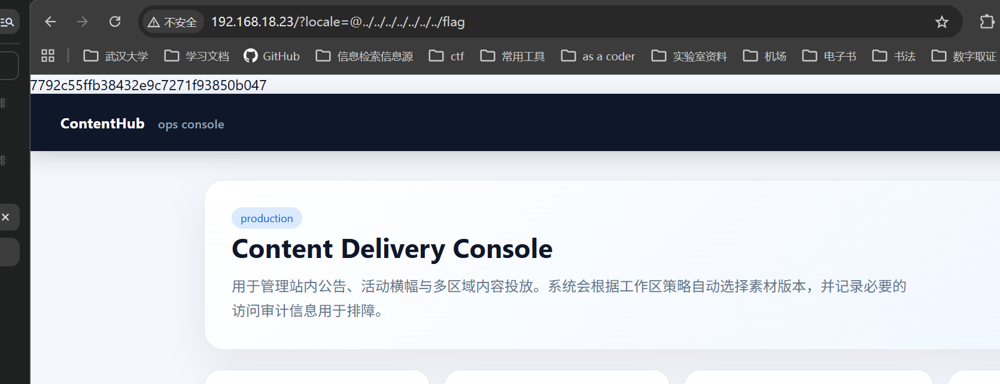
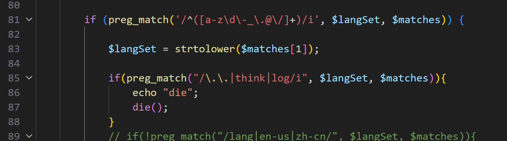
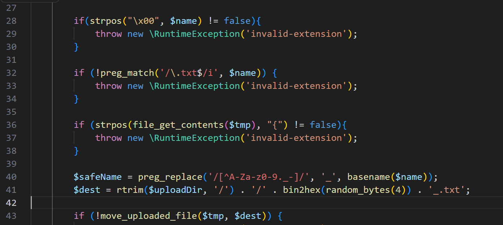
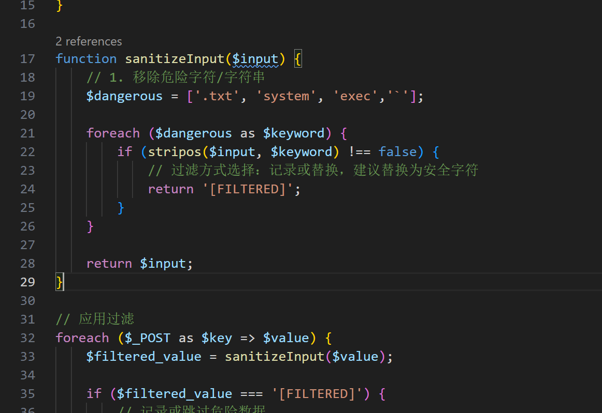
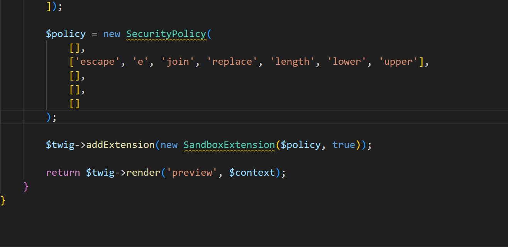

队伍名：All1n         联系电话： 13459992459          联系邮箱： 3046906637@qq.com

1、 **tp8_lang_probe-web01**

解题思路、相关代码和Flag截图：

 git看到修改的内容，就是langSet增加了@本地文件包含，直接读到flag了

 防御：

过滤了log和..

 

2、 web03

 twig模板注入 + 文件上传，maybe通过引用上传的文件

防御：

上传文件的地方过滤了一下

post参数做了简单过滤

模板渲染删了default和和slice，就这样糊里糊涂的过了。

