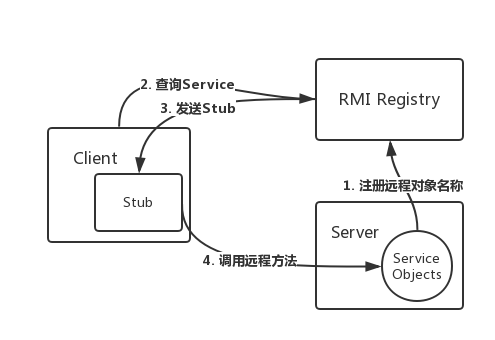
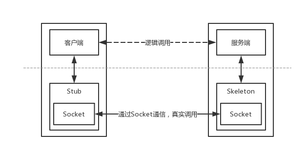
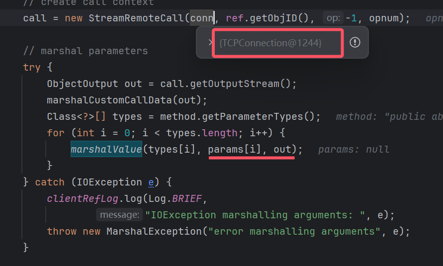
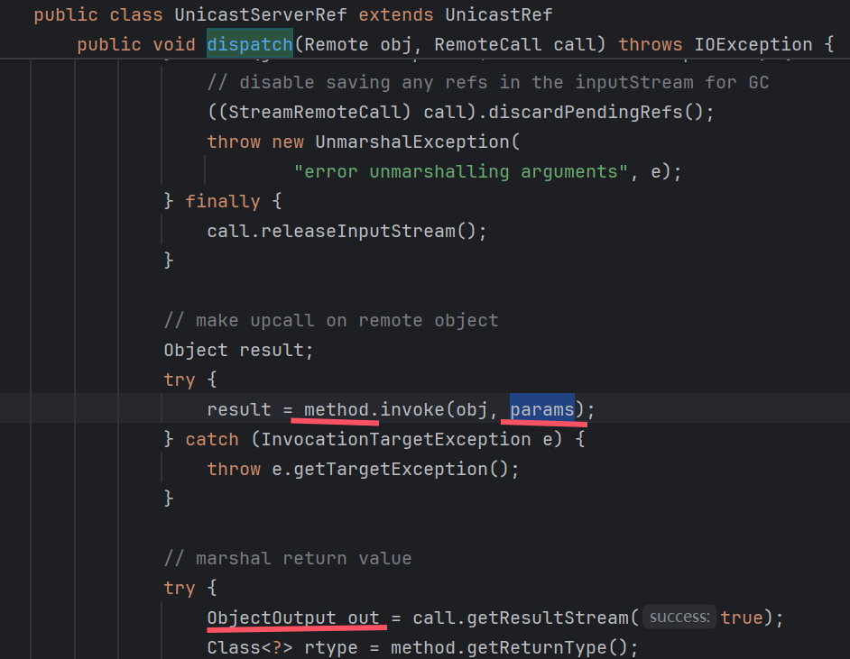

## RMI工作流程

https://kingx.me/Exploit-Java-Deserialization-with-RMI.html

rmi register是注册表，主要维护的是名字到远程对象 Stub 的映射（通过服务端bind来创建），Stub包括（服务端IP，Port，ObjID）

rmi客户端访问注册表，注册表返回服务端的Stub信息

其中，调用远程方法过程是先从Stub中获取服务端地址，建立TCP连接，把函数名、参数序列化写入TCP连接中，服务端接收到参数后，反序列化参数和指定方法并根据ObjID执行方法，然后把结果反序列化后返回给客户端。



因为stub是一个proxy, 执行stub的方法时, 其实执行的是handler的invoke方法

具体执行过程是:

```
at sun.rmi.server.UnicastRef.invoke(UnicastRef.java:161)
at java.rmi.server.RemoteObjectInvocationHandler.invokeRemoteMethod(RemoteObjectInvocationHandler.java:227)
at java.rmi.server.RemoteObjectInvocationHandler.invoke(RemoteObjectInvocationHandler.java:179)
at com.sun.proxy.$Proxy0.sayHello(Unknown Source:-1)
at Client.main(Client.java:16)
```



其实是客户端往与服务端的连接中写入要执行的方法, 参数

然后执行conn.getInputStream(), 转服务端执行

服务端会执行到sun.rmi.server.UnicastServerRef#dispatch



服务端反序列化客户端传入的method和params, 执行代码, 然后将结果写入out中,转客户端

客户端反序列化服务端传回的结果. 结束

Server/Registry实际上是一对特殊的C/S, Server也是先拿到Registry的Stub，然后执行registry.bind(name, obj), 然后转registry执行，ObjID对应的对象就是registryImpl，执行的bind方法，往bindings写入 (name, stub)

## RMI攻击手法

### 参数、结果反序列化


https://forum.butian.net/share/541

调用远程方法并得到结果, 涉及到两次反序列化, 分别是

1. 服务器反序列化参数 `ServerAttacker.RMIClient`
2. 客户端反序列化结果`services.ServiceImpl#process`

这两个很容易就可以实现，自己写的Remote接口高版本JDK可用。


registry相对于server（执行bind的一方），也是服务器, 反序列化bind(String name, Remote obj)

1. `ysoserial.exploit.RMIRegistryExploit` 就是把payload代理成Remote类，然后bind

2. 或者`RMI/RegistryAttacker/RMIClient.java:163`模拟bind函数的通信过程，registry反序列化name的时候就可以触发了。（服务端实现是`String name = (String) ois.readObject()` ）

```
bindLowLevel(regHost, regPort, cc6, cc6)
```

高版本JDK由于存在JEP290（？）过滤了dirty/clean/bind/lookup 入参（在反序列化的时候会检查），不可用

### DGC 机制

1. 正向dirty

   同样由于JEP290，JDK高版本（JDK8u202）不可用。

   registry和server都执行过exportObj，会存在DGC服务，Client可以dirty（续约），并且参数可以是gadget。目标会反序列化这个gadget实现RCE。实现: `ysoserial.exploit.JRMPClient` 

```txt 
（gadget触发）
at java.io.ObjectInputStream.readObject(ObjectInputStream.java:371)
at sun.rmi.transport.DGCImpl_Skel.dispatch(Unknown Source:-1)
at sun.rmi.server.UnicastServerRef.oldDispatch(UnicastServerRef.java:410)
at sun.rmi.server.UnicastServerRef.dispatch(UnicastServerRef.java:268)
```

registry的DGC服务器和registry本身一般是同一个端口，Server也一样。找到对应端口直接Dirty即可。`ServerAttacker.ByDCGDirty`

2. 反向

   JDK高版本（JDK8u202）可用

   实现DGC服务，让受害者来续约，并返回一个Exception，受害者会反序列化这个结果。

   DGC 服务实现：`ysoserial.exploit.JRMPListener`

   然后就是想办法投递给目标投递一个UnicastRef对象，指向我们的JRMPListener的端口，目标就会主动来续约。

   可以通过bind，打registry。`RegistryAttacker/RMIClient.java:175（dcg模式）`

   可以通过lookup返回UnicastRef对象，打Client。`ClientAttacker.GuideClient2JRMP`

   如何打Server? 通过前面的参数反序列化（unmarshall）出一个UnicastRef对象。

   可以通过反序列化投递（直接`java -jar ./target/ysoserial-0.0.6-SNAPSHOT-all.jar JRMPClient 127.0.0.1:7470 > payload.bin`）
