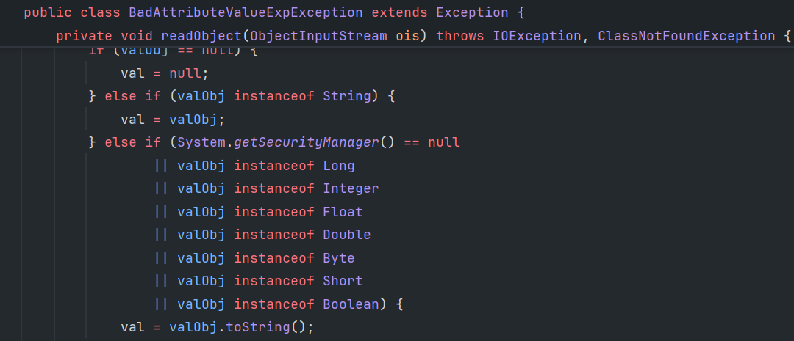

## call compare

### PriorityQueue

```txt
PriorityQueue#readObject
	PriorityQueue#heapfy
		PriorityQueue#siftDownUsingComparator
			<comparator>#compare(object, object)
```

comparator和比较对象object

```java
        PriorityQueue queue = new PriorityQueue(comparator);
        Object[] innerQueue = {object, object};
        Reflection.setFieldValue(queue, "queue", innerQueue);
        Reflection.setFieldValue(queue, "size", 2);
        Serializer.serialize(queue);
```

## call setter

这个是从json输入到对象构造，不是通过反序列化

### fastjson JSON#parse

```
com.alibaba.fastjson.JSON
```

### Jackson

从json到对象，调用无参构造函数以及setter


## call toString

### javax.management.BadAttribute

`JDK > 7u45 && JDK < 15 && System.getSecurityManager() == null`  

由于BadAttributeValueExpException在高版本中toString之前检查val对象是否是String类型，低版本无readObject。无 SecurityManager才会toString



## call hashCode

hashMap的key反序列化时候会执行hash(key)，调用key.hashCode


