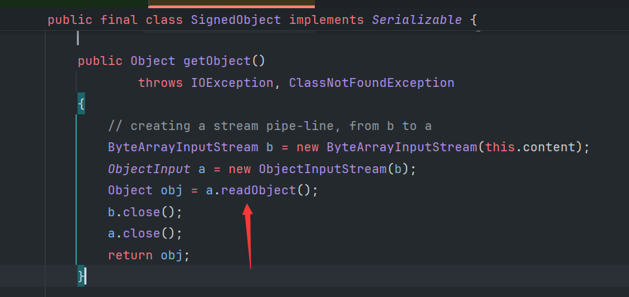
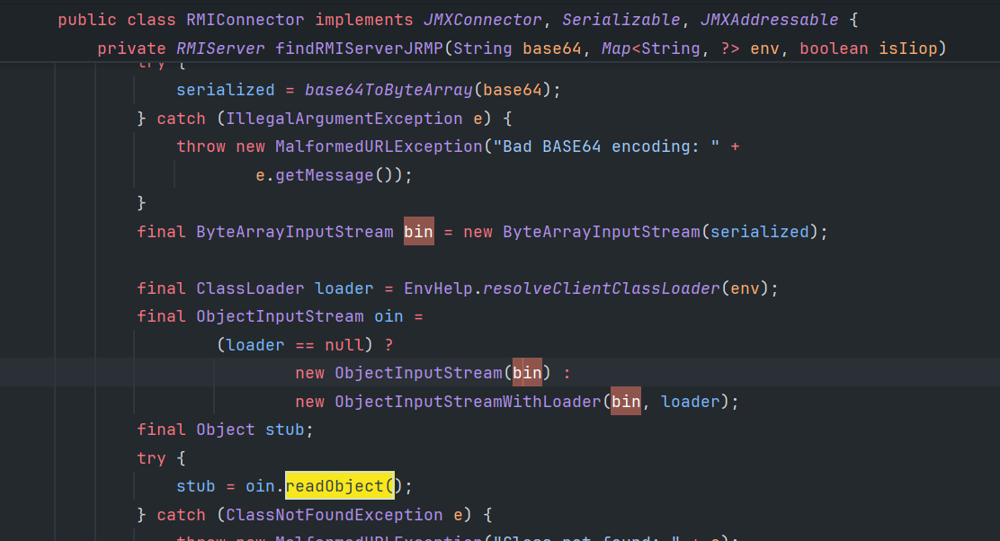
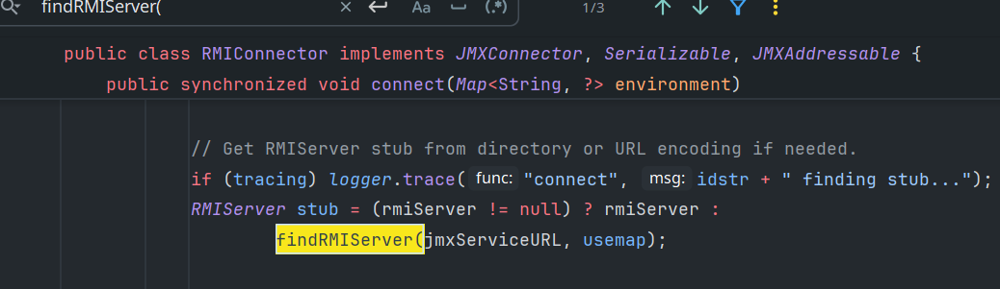
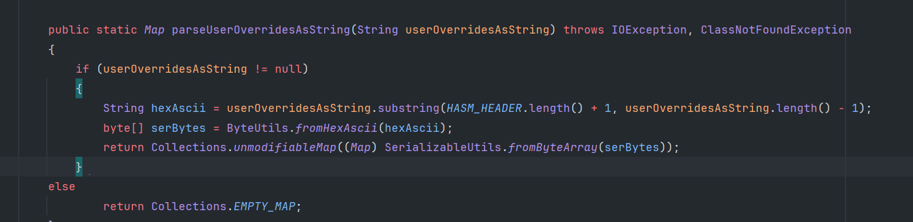

---
tags:	
  - java
  - 反序列化
---

## 使用场景

重写了`ObjectInputStream`，过滤了一些类，通过二次反序列化，由于第二次反序列化时使用的是普通的`ObjectInputStream`，因此不会有过滤，从而进行绕过。

## 可用类

java.security.SignedObject

javax.management.remote.rmi.RMIConnector

com.mchange.v2.c3p0.WrapperConnectionPoolDataSource

## SignedObject

执行getObject的时候反序列化content



需要配合调用getter的gadget

## RMIConnector

`findRMIServerJRMP`方法中base64解码数据并反序列化





需要能调用connect，并符合相应条件才行。

```
JMXServiceURL jmxServiceURL = new JMXServiceURL("service:jmx:rmi://");
setFieldValue(jmxServiceURL, "urlPath", "/stub/...base64payload...");
RMIConnector rmiConnector = new RMIConnector(jmxServiceURL, null);
rmiConnector.connect(null)
```

可以通过CC链InvokeTransformer来调用

- [ ] ndtd 实现一下用CC6+RMIConnector二次反序列化

## WrapperConnectionPoolDataSource

```txt
com.alibaba.fastjson.JSON#parse
com.mchange.v2.c3p0.impl.WrapperConnectionPoolDataSourceBase#setUserOverridesAsString
java.beans.VetoableChangeSupport#fireVetoableChange
com.mchange.v2.c3p0.WrapperConnectionPoolDataSource$1#vetoableChange
com.mchange.v2.c3p0.impl.C3P0ImplUtils#parseUserOverridesAsString
com.mchange.v2.ser.SerializableUtils#fromByteArray
com.mchange.v2.ser.SerializableUtils#deserializeFromByteArray
ObjectInputStream#readObject
```

即hex解码对应的userOverridesAsString变量后直接反序列化



需要配合setter调用使用
