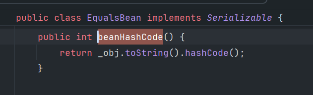
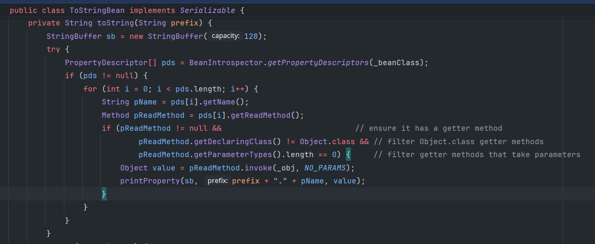

## Rome

### 堆栈

```txt
TemplatesImpl.getOutputProperties
at com.sun.syndication.feed.impl.ToStringBean.toString
at com.sun.syndication.feed.impl.EqualsBean.beanHashCode
at java.util.HashMap.hash
at java.util.HashMap.readObject
```

### 对象图

```txt
hashmap
	key = equalsBean
		_obj = toStringBean
			_beanClass = TemplatesImpl.class
			_obj = templatesImpl
```

EqualsBean#hashCode -> EqualsBean#beanHashCode -> ToStringBean#toString



ToStringBean的toString方法会在`_obj`上反射调用`_beanClass`上的getter方法



配合TemplateImpl#getOutputProperties实现字节码加载

## Jackson

依赖:

```xml
<dependency>
    <groupId>com.fasterxml.jackson.core</groupId>
    <artifactId>jackson-databind</artifactId>
    <version>2.13.3</version>
</dependency>
```

`spring-boot-starter-web`中自带这个。因此在springboot应用中可以用这个调用getter。

```txt
 badAttribute... # readObject
 POJONode # toString
 InternalNodeMapper # nodeToString
 ObjectWriter # writeValueAsString (templates)
 proxy.invoke ...
 TemplatesImpl # getOutputProperties
```

使用`org.springframework.aop.framework.JdkDynamicAopProxy`来解决getter调用顺序不固定导致的不稳定问题。由于Template类（TemplateImpl的接口）只有getOutputProperties这一个getter，用JdkDynamicAopProxy代理这个接口类，代理对象是TemplateImpl类实例。

## Spring-boot

springboot内置库的反序列化

